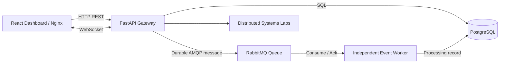

# AegisGrid — Distributed Emergency Response & Resource Coordination

AegisGrid is a distributed-systems mini-project that brings together an emergency-response command centre and an inspectable laboratory for distributed algorithms. It demonstrates a React dashboard, FastAPI service, PostgreSQL persistence, RabbitMQ messaging, a transactional outbox dispatcher, an idempotent consumer worker, Docker Compose and Kubernetes workloads.

> **Important distinction:** Incident/event APIs, database persistence, broker publication attempts, and worker consumption are real when the services are running. Clock synchronization, Lamport/vector clocks, global snapshots, leader election, mutual exclusion and heartbeat examples are deterministic educational simulations. Dashboard performance curves are illustrative until replaced with measurements collected from a live experiment. This academic project is not a real emergency-response dispatch system.

## Highlights

- High-detail dark operations dashboard with incident intake, status workflow, service topology, event forensics and scale/resilience runbook.
- Incident and event records stored in PostgreSQL.
- Synchronous HTTP endpoints plus a separate asynchronous RabbitMQ event path.
- Independent worker consumes durable queue messages and records processing acknowledgements.
- WebSocket ping/pong transport demonstration.
- Ten concept modules: physical clock synchronization, Lamport logical clocks, global snapshot, vector clocks, leader election, distributed mutual exclusion, heartbeat failure detection, message-oriented communication, stream-oriented communication, and container orchestration.
- Docker Compose stack and Kubernetes manifests with readiness/liveness probes and persistent database storage.
- Detailed architecture, concept workbook, deployment guides, experiment templates and demo script.

## Architecture



Components have independent container lifecycles. HTTP illustrates synchronous request/response. RabbitMQ decouples the event producer from the consumer. PostgreSQL persists incident state and the application event ledger.

## Quick start — Docker Compose

Requirements: Docker Desktop or Docker Engine with Compose v2.

```bash
cp .env.example .env
# Change the development passwords in .env before sharing this environment.
docker compose up -d --build
docker compose ps
docker compose logs --tail=100 api worker
```

Open:
- Dashboard: http://localhost:3000
- API documentation: http://localhost:8000/docs
- RabbitMQ management UI: http://localhost:15672

The defaults in `.env.example` are for local development only. Do not use them on a shared or production environment.

### Verify API, persistence and messaging

```bash
curl -fsS http://localhost:8000/health/ready
curl -fsS http://localhost:8000/api/overview
curl -X POST http://localhost:8000/api/events/demo
curl -fsS http://localhost:8000/api/events
docker compose logs --tail=100 api worker rabbitmq
```

The event API reports a broker result separately from database persistence. After the independent worker consumes the queue message, inspect the ledger for a `worker.processed` record. Publication does not by itself prove the worker finished processing.

Scale stateless consumers to demonstrate horizontal scaling:

```bash
docker compose up -d --scale worker=3
docker compose ps worker
```

## Local development without Docker

Backend (Python 3.12+):

```bash
cd services/api
python -m venv .venv
# Activate your venv, then:
pip install -r requirements.txt
pytest -q
uvicorn app.main:app --reload --port 8000
```

When `DATABASE_URL` is omitted, SQLAlchemy uses a local SQLite file for a light-weight dev/test loop. PostgreSQL + RabbitMQ behavior requires the stack/connection settings. Frontend (Node.js 20+):

```bash
cd frontend
npm install
npm run dev
npm run build
```

For the Vite dev server, set `VITE_API_URL` to the API URL when using endpoints (for example, `http://localhost:8000/api`). The Docker/Nginx build is configured to proxy `/api-proxy/*` to the API.

## Kubernetes

The repository includes the namespace and application stack manifest in `infrastructure/kubernetes/`. Build local images and load them into your local cluster if required. Review and replace development credentials in the Kubernetes Secret before applying.

```bash
docker build -t aegisgrid-api:local ./services/api
docker build -t aegisgrid-frontend:local ./frontend
kubectl apply -f infrastructure/kubernetes/namespace.yaml
kubectl apply -f infrastructure/kubernetes/app-stack.yaml
kubectl get deployments,pods,services,pvc -n aegisgrid
kubectl rollout status deployment/aegisgrid-api -n aegisgrid
kubectl logs deployment/aegisgrid-worker -n aegisgrid --tail=100
```

On kind, load local images using `kind load docker-image aegisgrid-api:local aegisgrid-frontend:local`. Your cluster's storage class, image loading, host networking and NodePort access may need adjustment.

Scale the API or consumer in a development-only cluster:

```bash
kubectl scale deployment/aegisgrid-api --replicas=3 -n aegisgrid
kubectl scale deployment/aegisgrid-worker --replicas=3 -n aegisgrid
kubectl get pods -n aegisgrid -w
```

PostgreSQL and RabbitMQ are configured as singleton stateful workloads in these learning manifests. Do not scale them by simply raising replica counts; clustering/replication requires a separate stateful design.

## API surface

| Endpoint | Purpose |
|---|---|
| `GET /health/live` | Process liveness |
| `GET /health/ready` | API readiness including database reachability |
| `GET /api/overview` | Incident metrics, component indicators, recent events |
| `GET /api/incidents` | List incidents |
| `POST /api/incidents` | Create an incident and event |
| `PATCH /api/incidents/{id}` | Update incident state |
| `GET /api/events` | Read event ledger |
| `POST /api/events/demo` | Publish a demonstration event |
| `GET /api/concepts` | List concept modules |
| `GET /api/labs/{lab_id}` | Return a lab trace/runbook |
| `WS /ws/events` | Minimal live WebSocket ping/pong example |
| `GET /docs` | Swagger API documentation |

## Repository layout

```text
AegisGrid/
├── frontend/                         # React + TypeScript operations dashboard
│   ├── src/App.tsx                   # Pages, concept labs and UI state
│   ├── src/styles.css                # Responsive visual system
│   ├── Dockerfile                    # Multi-stage image
│   └── nginx.conf                    # API/WebSocket proxy + SPA fallback
├── services/api/
│   ├── app/main.py                   # FastAPI gateway and HTTP/WebSocket routes
│   ├── app/db.py                     # SQLAlchemy incident/event models
│   ├── app/broker.py                 # RabbitMQ publisher
│   ├── app/worker.py                 # Independent consumer process
│   ├── app/labs.py                   # Distributed-systems teaching models
│   ├── tests/test_api.py             # API test cases
│   └── Dockerfile
├── infrastructure/kubernetes/
│   ├── namespace.yaml
│   └── app-stack.yaml                # Frontend, API, worker, DB and broker workloads
├── docs/
│   ├── ARCHITECTURE.md
│   ├── CONCEPT_DEMONSTRATIONS.md
│   ├── DOCKER_GUIDE.md
│   ├── KUBERNETES_GUIDE.md
│   ├── EXPERIMENTS.md
│   └── DEMO_SCRIPT.md
├── docker-compose.yml
└── .env.example
```

## Concept modules

1. **Physical clock synchronization:** Berkeley-style mean offsets and signed correction.
2. **Lamport logical clocks:** event counters and happened-before ordering.
3. **Global snapshot:** process and in-transit channel state, Chandy–Lamport-style.
4. **Vector clocks:** causal ordering versus concurrency.
5. **Leader election:** Bully algorithm model with a failed node.
6. **Mutual exclusion:** Ricart–Agrawala request ordering model.
7. **Failure detection:** heartbeat miss threshold and false suspicion.
8. **Message-oriented communication:** durable RabbitMQ queue and independent consumer.
9. **Stream-oriented communication:** WebSocket connection, frame and keepalive lifecycle.
10. **Container orchestration:** Docker and Kubernetes operational observations/runbooks.

See [Concept Demonstrations](docs/CONCEPT_DEMONSTRATIONS.md) for the full lab workbook and presentation walkthrough.

## Tests and build checks

Backend tests:

```bash
cd services/api
pip install -r requirements.txt
pytest -q
```

Frontend production build:

```bash
cd frontend
npm install
npm run build
```

Run the checks in the target environment before describing them as passing. This repository update has not been executed in your own Docker/Kubernetes cluster.

## Engineering limitations and next steps

The current academic baseline keeps service boundaries understandable and avoids claiming production-grade delivery guarantees. Important next improvements:
- Transactional outbox to coordinate database changes with broker publication.
- Idempotent consumer and retry limits/dead-letter queue.
- Database migration tooling, event schema versioning and structured JSON payload columns.
- Authentication/authorization for incident operations.
- Metrics, structured logs, tracing and repeatable load-test harness.
- Secure secret management, TLS, NetworkPolicies and appropriate persistent/HA designs for PostgreSQL/RabbitMQ.

## Academic and safety note

AegisGrid is a software engineering demonstration. Do not use it for real emergency coordination. Protocol traces and prepopulated chart data are synthetic; runtime health or scaling conclusions should be supported by actual command output and recorded measurements.

## Detailed implementation and demonstration

The current implementation branch adds persisted resource inventory/reservations and a stepwise experiment workbench. See:
- [Project Analysis Gap Audit](docs/PROJECT_ANALYSIS_GAP_AUDIT.md) — requirement-by-requirement gap analysis and acceptance gate.
- [Docker & Kubernetes Demonstration Runbook](docs/DOCKER_KUBERNETES_DEMONSTRATION.md) — full run sequence for Compose, incident/resource workflow, RabbitMQ worker, Kubernetes rollout/scaling, Pod recovery, and evidence capture.
- [Scalability and Resilience Experiments](docs/EXPERIMENTS.md) — controlled experiments and measurement requirements.
- [HTTP Load Probe](scripts/http_load_probe.py) — real HTTP latency/throughput samples with JSON report output.
- [Kubernetes Recovery Probe](scripts/k8s_recovery_probe.py) — guarded Pod replacement readiness timing, requires explicit `--confirm` and is restricted to the `aegisgrid` namespace.
- [Manifest Validator](scripts/validate_manifests.py) — structural check of required Compose services, Kubernetes workloads, PVC and optional HPA; not a substitute for deploying to a cluster.
- [API OpenAPI](http://localhost:8000/docs) after starting the stack.

### Added API routes

| Route | Purpose |
|---|---|
| `GET /api/resources` | List persisted field units/facilities/resources |
| `POST /api/resources` | Register a resource with optional coordinates |
| `POST /api/resources/demo-seed` | Idempotently seed sample resource inventory |
| `GET /api/reservations` | List reservation history |
| `POST /api/reservations` | Reserve an available resource; returns 409 on conflict |
| `POST /api/reservations/{id}/release` | Release a reservation and restore availability |
| `POST /api/experiments` | Create a persisted, parameterized concept trace |
| `GET /api/experiments` | List recent saved runs |
| `GET /api/experiments/{id}` | Retrieve a saved run |
| `POST /api/experiments/{id}/step` | Advance one event in the saved trace |
| `POST /api/experiments/{id}/reset` | Reset the saved trace cursor |
| `POST /api/beacons/simulate` | Generate a configurable heartbeat timeout/recovery trace |
| `GET /api/forensics/{incident_id}` | Reconstruct chronologically matching persisted incident events |
| `GET /api/outbox` | Inspect event outbox state and publication attempts |
| `POST /api/outbox/{id}/retry` | Retry a pending outbox message explicitly |
| `POST /api/experiments/{id}/pause` and `/resume` | Pause/resume a persisted trace cursor |
| `POST /api/experiments/{id}/inject-failure` | Insert a labelled simulated fault into a trace; no real service is stopped |

### Run the new panels

Start Docker Compose as described below, open the dashboard, then:
1. Open **Resources & units** and select **Load sample resources**. Inspect the map markers and database-backed inventory; register a resource and reserve/release it.
2. Open **Experiment workbench**. Select a concept, configure supported parameters, create a run, step through events, reset and reopen a saved run. Copy the JSON evidence for your report.
3. Follow the Docker/Kubernetes runbook to inspect actual service state and collect load/recovery measurements.

**Limitations remain explicit:** lab traces are educational simulations or workflow templates rather than full distributed protocol engines; pause/resume and arbitrary failure injection are not yet implemented. The map uses sample coordinates and external OpenStreetMap tiles, not live GPS. Docker/Kubernetes operations pages provide safe CLI runbooks rather than direct runtime control. Do not report synthetic chart values as measured performance.
