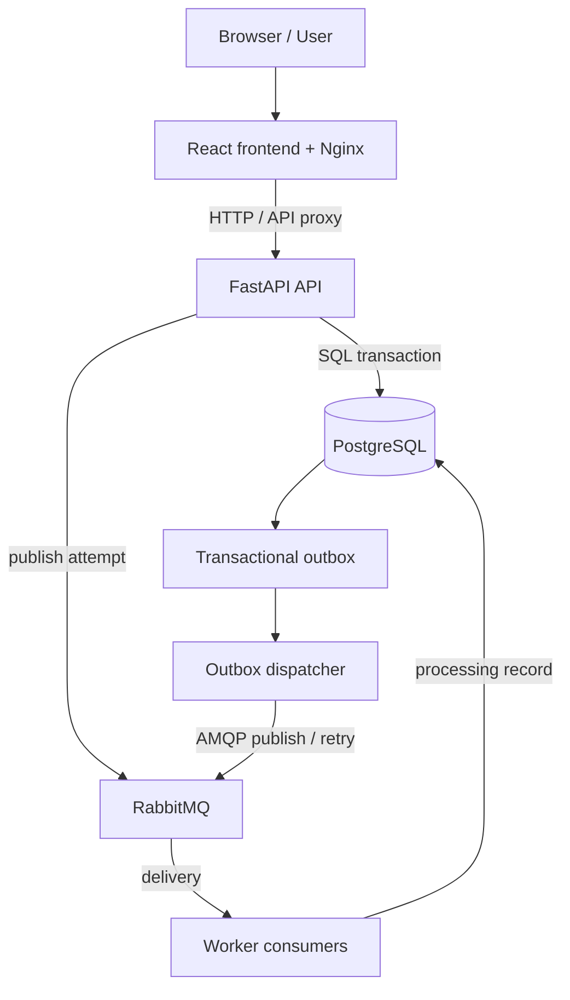

# Project Analysis Report — Repository Gap Audit

**Repository:** AnushkaSomawanshi/AegisGrid  
**Acceptance basis:** The user's detailed AegisGrid mini-project blueprint and UI/demonstration specification supplied in the project-analysis chat.  
**Purpose:** Compare the actual repository implementation with the required end-to-end demonstrations. This is a gap audit, not a claim that absent behavior is implemented.

## Executive result

The repository has advanced beyond the initial audit snapshot. The current source includes persisted resource and reservation endpoints, persisted experiment runs, event/outbox recording, an outbox dispatcher, an independently running RabbitMQ worker, event-ID deduplication, a richer React dashboard, a load-probe script, Kubernetes manifests, CI checks, and deployment runbooks. These are source-level findings; they do not by themselves prove a clean local deployment or a real Kubernetes cluster rollout.

The purpose of this document is to track the difference between code/configuration, automated CI evidence, a successful local PC run, and actual Kubernetes runtime evidence. Do not mark the project fully accepted until the corresponding gates below have been executed and recorded.

## Source-of-truth requirements

The intended project consists of:
- **Emergency Command Centre:** incidents, resources/facilities, reservation workflows and activity/event views.
- **Distributed Systems Laboratory:** dedicated educational demonstrations, scenario controls, execution traces, computed results and documented invariants.
- **Infrastructure and Reliability Centre:** practical Docker/Kubernetes operations, scaling and recovery runbooks, health checks, and measured experiments.

A source file or UI element is not, by itself, proof that the user-facing workflow or deployment succeeds. Each requirement needs an implemented path, appropriate tests, a repeatable demonstration and evidence. Educational traces must be labelled as simulations rather than live protocol activity.

## Current implementation status

Status meanings:
- **IMPLEMENTED — SOURCE:** related code or route exists; runtime still needs verification.
- **PARTIAL:** meaningful behavior exists, but broader acceptance criteria remain unmet.
- **SIMULATION:** deterministic teaching model, not live distributed state.
- **UNVERIFIED:** requires current CI evidence or an actual local/cluster run.
- **FUTURE HARDENING:** current baseline exists but production-style safeguards remain.

| Requirement | Current status | Evidence / remaining gate |
|---|---|---|
| Dashboard shell and responsive UI | IMPLEMENTED — SOURCE | Run frontend build and verify the dashboard in a browser against a running stack. |
| Incident create/list/status workflow | IMPLEMENTED — SOURCE | Exercise endpoints and verify persisted state. |
| Resource inventory and reservation workflow | IMPLEMENTED — SOURCE | Verify demo seed, create, reserve, conflict and release paths; confirm persisted state. |
| Event ledger and outbox | IMPLEMENTED — SOURCE / PARTIAL | Event plus outbox envelope are recorded together; incident persistence occurs in a separate earlier transaction. Test failure boundaries. |
| Independent outbox dispatcher and RabbitMQ worker | IMPLEMENTED — SOURCE / UNVERIFIED RUNTIME | Verify a unique event progresses to a persisted worker-processing record. |
| Worker event-ID deduplication | IMPLEMENTED — SOURCE / FUTURE HARDENING | Do not promise end-to-end exactly-once; bounded retry and poison-message dead-letter behavior remain hardening work. |
| Persisted experiment runs and supported controls | IMPLEMENTED — SOURCE | Test create/inspect/step/reset and other documented supported actions, including trace export where provided. |
| Physical clock / Berkeley-style lab | SIMULATION | Synthetic clock offsets and corrections; does not alter host clocks or contact NTP. |
| Lamport and vector clock labs | SIMULATION / PARTIAL | Educational traces with dedicated studio behavior; not live instrumentation of service messages. Verify modeled invariants. |
| Global snapshot lab | SIMULATION / PARTIAL | Models process/channel recording and trace order; does not snapshot real Docker/Kubernetes state. |
| Bully election and mutual exclusion labs | SIMULATION / PARTIAL | Educational protocol state/trace, not a real production coordinator or distributed lock service. |
| Heartbeat/beacon failure detection | SIMULATION / PARTIAL | Simulated missed heartbeats/timeouts; not OS/container liveness observation. |
| Messaging and WebSocket/stream labs | PARTIAL | RabbitMQ path is part of the running application. WebSocket transport remains a minimal demonstration, not a global production telemetry stream. |
| Incident forensics | PARTIAL | Endpoint provides a chronological forensic view; complete causal graphs need stronger correlation/causation metadata. |
| Resource map | IMPLEMENTED — SOURCE / DEMO DATA | Seeded coordinates are examples, not live GPS. |
| Docker Compose | IMPLEMENTED — CONFIGURATION / UNVERIFIED PC RUN | Six services, health dependencies and named PostgreSQL volume are declared. Must be started and checked on the target PC. |
| Kubernetes profiles | IMPLEMENTED — CONFIGURATION / UNVERIFIED CLUSTER RUN | Two separate profiles exist. Apply one profile only and record Pods, PVC, endpoints, scaling and recovery from a real development cluster. |
| Live Docker/Kubernetes operations console | NOT CLAIMED | The operational workflow is runbook/CLI-oriented; do not represent it as a remote runtime control API. |
| Actual scalability/performance conclusions | UNVERIFIED | Use a fixed workload, repeated trials and raw measurement outputs. Synthetic dashboard charts are not measurements. |
| CI | CONFIGURED | Workflow defines backend tests, frontend build, manifest checks and Compose smoke test. Inspect Actions for the exact commit under evaluation. |

## Required target UI (source specification)

### Command Centre
- Global header: environment (Local/Docker/Kubernetes), counts, connection status and refresh.
- Incident queue with severity/region/assignment/state filters, search, sorting and quick selection.
- Geographic map with incident, field-unit and resource markers, layers, selected item and list fallback.
- Detail panel with assigned resources, recommendations, missing information, timeline, messages and audit history.
- Actual operational event feed linking to associated event trace.
- Visible per-stage path: UI → API → database → RabbitMQ → consumer → dashboard; each stage shows actual result/error.

### Common lab page template
1. Objective, theory, formulas, assumptions and limitations.
2. Topology of processes/channels/roles/resource ownership.
3. Scenario selector and meaningful parameter settings.
4. Load example / Run / Step / Pause / Resume / Reset.
5. Supported failure injection with labels distinguishing simulation from actual infrastructure action.
6. Execution timeline, message inspector and before/after state.
7. Computed results and automated invariant/consistency checks.
8. Normal, edge and failure experiments.
9. Persisted run history, comparison and exportable evidence.

### Specific lab acceptance criteria
- **Clock:** five editable offsets, per-node availability, calculated mean and correction, exclude unavailable participant and compare means; backend-authoritative result and tests.
- **Lamport:** process lanes, event triggers and message arrows; show clock before/after; assert causal order.
- **Snapshot:** run marker steps; capture process and channel states; detect/illustrate a consistent versus inconsistent cut.
- **Vector:** create events and message receive; update vectors; compare causal/concurrent pairs; produce graph.
- **Election:** inject node/leader failure; show election request/response messages, winner announcement and result assertions.
- **Mutual exclusion:** competing requests and permission messages; track lock/ownership transitions; assert that no two processes own one resource at once.
- **Beacon:** adjustable heartbeat interval/timeout, pause a sender, count misses, show suspect/unavailable/recovery; clearly separate simulated and live mode.
- **Messaging:** publish message, inspect actual queue state, consume/ack, interrupt consumer, show backlog and recovery; deduplicate redelivery.
- **Streaming:** actual telemetry feed, sequence and timestamps, disconnect/reconnect and sequence-gap metrics.
- **Forensics:** select an incident, construct graph from correlated event IDs and message causality, inspect paths, export report.
- **Docker console:** tabs for containers, logs, services/volumes and safe actions, backed by read-only/limited Docker API integration.
- **Kubernetes console:** cluster overview, workload explorer, scaling/recovery, logs/events. Use a least-privilege backend ServiceAccount; never place kubeconfig/admin tokens in browser.
- **Scale lab:** reproducible workload parameters; compare identical workload on baseline/scaled deployments; save actual successes, failures, throughput, p50/p95, duration, replica counts and CPU/memory where available.
- **Reliability lab:** consumer outage, controlled timeout/retry, duplicate event, container restart/Pod deletion; record start/recovery times, affected operations, retries, errors and final durable state.
- **Evidence/reporting:** each run saves scenario, parameters, code/runtime version, trace, measurements, invariant results, conclusion and export output.

## Recommended implementation order

### Phase 1 — Complete operational domain and event chain
1. Add durable Resource, Unit/Facility, Reservation and telemetry domain models and API groups.
2. Define versioned message envelope with event ID, correlation ID, causation ID and timestamps.
3. Implement transactional outbox (or explicitly test/document partial failure) and idempotent consumer; bound retries and route poison messages to dead letter.
4. Build correlated end-to-end incident trace with explicit stage status and actual failures.
5. Add end-to-end integration tests for persistence, broker publish, consume, deduplication, unavailable consumer, restart and final state.

### Phase 2 — Turn static examples into execution engines
1. Use a shared run/scenario/step/event/result schema but separate state machines per concept.
2. Add dedicated endpoints: `/api/clock-sync`, `/api/lamport`, `/api/global-snapshot`, `/api/vector-clock`, `/api/election`, `/api/mutual-exclusion`, `/api/beacons`.
3. Add `/api/experiments` endpoints for create/run/step/pause/reset/inspect/compare/save/export.
4. Add one or more worked scenarios, edge cases, injected failures and automated invariants per lab.
5. Replace lab fallback values with backend execution state; keep fallback only as clearly labelled offline preview.

### Phase 3 — Communication, forensic graph and evidence
1. Add real streaming telemetry generation and WebSocket status/history; reconnect logic and sequence-gap tracking.
2. Add `/api/messaging` inspection/trace/retry/dead-letter observability.
3. Add `/api/forensics` to build correlated and causal event graph; support selected-node event inspection and report export.
4. Store every experiment run and attach actual logs, trace, metrics, assertions and interpretation.

### Phase 4 — Runtime integrations and measurements
1. Add safe Docker runtime adapter for read-only container/service/log metadata; destructive actions should require authentication and explicit confirmation.
2. Add least-privilege Kubernetes adapter and UI for namespace/workload/Pod/service/events/logs and observed replica state.
3. Add fixed-load test harness and baseline/scaled run comparison.
4. Test consumer outage, timeout, duplicate event, container/Pod restart and measure actual recovery.
5. Validate manifests/secrets/config, run Compose end-to-end, run Kubernetes in a target cluster, capture evidence, and document which results are measured.

### Phase 5 — Acceptance gate
Do not label the project complete until every requirement has:
- an implemented backend/UI operation,
- automated tests for its key rule/invariant,
- a repeatable demonstration case,
- saved trace/result evidence,
- clear simulation vs runtime labels,
- and a documented result or an explicit known limitation.

## Deployment caveat

The Kubernetes manifests and Docker Compose file are configuration artifacts. Their existence is not proof that a deployment ran successfully. The actual runtime integration, cluster access, workload scaling and failure recovery must be exercised in the user's development environment. Any performance figures must come from those measured runs, not from the UI illustration.

## Implementation progress — feature branch increment (2026-10-20)

The following items have since been added on branch `feature/aegisgrid-complete-demonstrations` and are awaiting CI/review via PR #4:
- SQL persistence models for resources, reservations, experiment runs, transactional outbox and unique processed-message IDs.
- Resource list/create/idempotent demo seed endpoints; reservation, conflict response and release endpoint.
- A conditional availability update for reservation to reduce double-reservation races on PostgreSQL.
- Persisted experiment runs with parameter/result/trace payload, step, reset, pause, resume, and labelled simulated fault insertion.
- Beacon timeout/missed-heartbeat simulation and chronological incident-forensics endpoint with an explicit causality limitation.
- Transactional event + outbox commit, independent polling outbox dispatcher, outbox inspection/manual retry endpoints, RabbitMQ publisher confirms, and worker deduplication by stable event ID.
- New frontend pages: interactive OpenStreetMap resource markers, resource registration/reservation/release, experiment trace workbench, and outbox/worker trace console.
- Real HTTP load probe script, optional API HPA manifest, and detailed Docker/Kubernetes runbook.

This is meaningful progress but **does not close the whole acceptance checklist**. Remaining major work includes full algorithm state machines/invariants, bounded retry/backoff and a poison-message dead-letter policy, causal IDs/graph, real telemetry stream, live Docker/Kubernetes runtime adapter, measured end-to-end load/fault tests, and running the stack/cluster in an actual development environment. Current map markers are seeded example coordinates and do not represent live GPS.

---

## Repository audit and deployment acceptance baseline — 2026-10-22

This section supersedes older point-in-time status statements where they conflict with the current repository. It records the scope of the audit and defines the evidence required before AegisGrid is described as fully validated.

### Project requirement

The assignment is to design, develop and deploy a small distributed application using Docker, Kubernetes or an equivalent container/orchestration platform. The implementation must demonstrate inter-service communication and a credible scalability experiment. A polished interface or a structurally valid manifest alone does not satisfy the deployment requirement.

### Current repository evidence inspected

The following files were inspected on `main` during this audit:

- `docker-compose.yml`, `frontend/Dockerfile`, `frontend/nginx.conf`, `services/api/Dockerfile`, `services/api/requirements.txt`.
- `infrastructure/kubernetes/namespace.yaml`, `infrastructure/kubernetes/app-stack.yaml`, `infrastructure/kubernetes/api-hpa.yaml`.
- `deploy/kubernetes/kustomization.yaml` and the manifest validator's referenced local-cluster resources.
- `.github/workflows/ci.yml`, `scripts/validate_manifests.py`, `scripts/k8s_recovery_probe.py`, and `services/api/tests/test_api.py`.
- `README.md`, `docs/DOCKER_GUIDE.md`, `docs/KUBERNETES_GUIDE.md`, `docs/DOCKER_KUBERNETES_DEMONSTRATION.md`, `docs/EXPERIMENTS.md`, and this gap audit.

The Compose file declares six services: frontend, API, worker, outbox dispatcher, PostgreSQL and RabbitMQ. It defines a named database volume and health checks for API/database/broker. The API code includes database-backed event recording and an outbox envelope, and attempts broker publication. These are source-level findings; they do not by themselves prove successful runtime delivery or worker processing.

The main Kubernetes profile under `infrastructure/kubernetes/` defines application Deployments/Services, a PostgreSQL PVC, development placeholder Secret values, and an optional API HPA. The repository also maintains a separate laptop-local Kustomize profile under `deploy/kubernetes/`. These are two deployment profiles, not a single manifest set. Their configuration and documentation must be kept in sync, and the chosen profile must be named explicitly in demonstration evidence. The local profile's development credentials are not suitable for shared or production use.

### Architecture diagram

The diagram is the intended event path. The actual success/failure of each edge must be established by runtime logs and integration tests; API success must not be treated as proof of broker delivery, consumer processing, or acknowledgement.

### Deployment and validation matrix

| Requirement | Repository evidence | Acceptance evidence still required |
|---|---|---|
| Reproducible frontend and API images | Separate Dockerfiles exist | Build both images from a clean checkout |
| Service networking | Compose service DNS and Nginx API proxy are configured | Compose smoke test verifies browser/API reachability |
| Persistent state | Compose named volume and Kubernetes PVC are declared | Create data, restart workload, verify data survives |
| Inter-service messaging | RabbitMQ, dispatcher and worker are declared; API has outbox/publication logic | Publish a unique event and verify persisted consumer-processing evidence |
| Container health | Compose health checks and Kubernetes API/frontend probes exist | All expected services/Pods become healthy/Ready |
| Scaling | Compose worker scaling instructions and optional API HPA exist | Scale a fixed workload, record replicas and processing outcomes |
| Kubernetes recovery | Guarded recovery probe script exists | Run only in a disposable cluster and record replacement readiness |
| Frontend build | CI has a frontend production-build job | Latest branch CI passes; no unverified local claims |
| Backend tests | CI has a pytest job | Latest branch CI passes, including integration coverage where configured |
| Manifest structure | Static validator exists | Validator and rendered configuration checks pass |
| Live Kubernetes deployment | Manifests and guides exist | Apply to kind/minikube/Docker Desktop Kubernetes and record actual Pod/service state |

### Pull-request state audit

Status checked on 2026-10-22. The following PRs were returned by the repository PR search and individually inspected:

- **Merged:** #2, #4, #5, #6, #7, #8, #14, #15, #16, #17, #20, #24, #25, #26 and #27.
- **Open and not mergeable at inspection time:** #1, #10, #12 and #23.
- PR #10 (Mutual Exclusion) and PR #12 (Heartbeat Suspicion) overlap in scope with the merged combined implementation in #20. Do not merge them as-is; compare their unique changes against `main`, then close them if all useful functionality is already present.
- PR #1 is an older foundation PR and must be compared against the much more complete merged implementation before any action. Do not merge it just to clear the open-PR list.
- PR #23 adds a Communication Control Room wrapper beyond the existing message/stream studio merged through #14. It remains unmerged and was reported non-mergeable due to branch conflict. Do not merge until conflicts are resolved, the new component is compared with existing routes, and CI/runtime acceptance passes.

“Closed” is not synonymous with “merged”; the merged state was checked separately. This list is a snapshot, not a live GitHub status guarantee.

### Canonical deployment policy

- `docker-compose.yml` is the canonical local multi-container launch path.
- `infrastructure/kubernetes/` is the documented application-stack manifest path, with `api-hpa.yaml` applied only when metrics-server and CPU metrics are available.
- `deploy/kubernetes/` is a separate Kustomize profile intended for laptop-local clusters. Keep it only while it offers a documented, tested use case; otherwise consolidate it into the canonical profile in a dedicated reviewed change. Never silently let the two profiles drift.
- Do not commit real secrets. Placeholder credentials must be replaced through a secure local/cluster secret workflow before shared use.
- Use a cluster context check and a disposable namespace/cluster before any destructive recovery experiment.

### Acceptance gates

1. **Static:** YAML parses; Compose and Kustomize references exist; workload/service selectors, probes, storage and HPA targets are structurally consistent.
2. **Build:** frontend production build and API image build succeed from a clean checkout.
3. **Unit/API:** backend tests and frontend TypeScript/build checks pass.
4. **Compose integration:** the full stack becomes healthy; API persistence works; a unique event reaches the broker and worker; processing evidence is observable.
5. **Kubernetes integration:** selected profile applies successfully; expected Pods are Ready; service-to-service calls work; PVC binds; a controlled replica scale changes actual ready replicas.
6. **Recovery/scalability:** use fixed input workloads, record versions and environment, repeat runs, and report raw observations. Do not claim throughput improvements without measurements.
7. **Documentation:** commands match the tested profile; architecture/sequence diagrams match the implementation; every limitation is explicit; no broken internal links or stale claims remain.

### Current validation limitation

GitHub source inspection confirms that CI is configured for backend tests, frontend build, manifest validation and a Docker Compose smoke test. At the time of this audit, the available status/run lookup did not return check results for the inspected latest commit. Therefore the existence of CI configuration is confirmed, but a passing current run and a successful Kubernetes cluster deployment are **not verified by this audit**. Record the actual CI run and cluster evidence before marking these gates complete.
